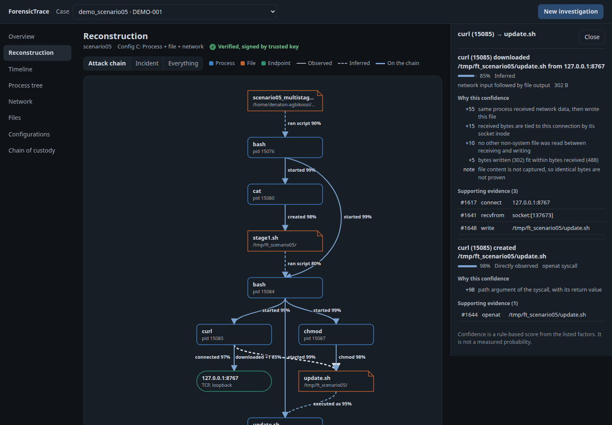

# Dashboard and incident reconstruction

The dashboard lets an analyst run an investigation and understand the incident without reading
JSON or terminal output. It sits on top of the C engine and does not replace it: the engine
collects, hashes and verifies; the dashboard reads the JSON it writes and calls the binary.

```bash
make            # build the engine
make keys       # optional: signing key for new evidence
make dashboard  # http://127.0.0.1:8377
```

It needs only the Python standard library and has no external scripts or fonts, so it works on
an isolated analysis machine. Options: `--port`, `--evidence-dir DIR` (repeatable), `--sign-key`, `--pubkey`.



## Views

| View | What it answers |
|---|---|
| Overview | The five totals, plain answers to the investigator's questions, suspicious activity, and the attack chain's weakest link |
| Reconstruction | The relationship graph; select a line for its events and how its confidence was reached |
| Timeline | What happened, when, and which process did it. Drag to zoom, filter, search |
| Process tree | Parent and child processes, when each ran, how the execution chain developed |
| Network | Source and destination address and port, protocol, state, bytes |
| Files | Files created, modified, read, deleted or denied, and by whom |
| Configurations | A to D compared on quality, storage, CPU and processing time, from the study's results |
| Chain of custody | Verification result, record-level problems, audit log, export |

**New investigation** traces a listed scenario. To trace your own command, run the engine with
`--output cases/name.json`; the file appears in the case list.

## How the reconstruction works

`scripts/reconstruct.py` builds the graph from an evidence file. It also works alone:

```bash
python3 scripts/reconstruct.py cases/run.json
python3 scripts/reconstruct.py cases/run.json -o graph.json
```

**Observed** relations come straight from syscalls. **Inferred** relations connect observations
the kernel never linked itself, and every one lists its evidence and its reasoning.

| Relation | Tier | Basis | Score |
|---|---|---|---|
| started | observed | parent's fork/clone returned this PID (0.80 when only the child's PPID links them) | 0.99 |
| created, overwrote, deleted, changed mode, denied | observed | path argument and return value | 0.98 |
| wrote, read | observed | file descriptor resolved through `/proc` at the time of the call | 0.95 |
| connected | observed | `connect()` with data on the socket (0.70 when no data was seen) | 0.97 |
| downloaded | inferred | received from a socket, then wrote the file | 0.55 to 0.85 |
| executed as | inferred | same path written earlier in the trace, then executed | 0.70 to 0.95 |
| ran script | inferred | an interpreter read the file | 0.55 to 0.90 |

The download score starts at 0.55 for "same process received, then wrote". It gains 0.15 if the
bytes are tied to the connection by socket inode, 0.10 if no other non-system file was read in
between, and 0.05 if bytes written fit within bytes received. Execution starts at 0.70 and gains
0.10 if the file was not deleted in between, 0.10 if execute permission was added, and 0.05 if
writer and executor share a process tree. A chain is reported with its weakest link.

**These scores are rule-based. They are not measured probabilities and have not been calibrated
against data.** They rank how much evidence stands behind a claim. File contents and inodes are
not captured, so "this file came from that socket" is never proven, and the score says so.

## Suspicious activity rules

Rules are simple and every finding cites its events. They look for known patterns only, so an
empty list is not proof of a clean system.

| Rule | Severity | Fires when |
|---|---|---|
| FT-DOWNLOAD-EXEC | critical | a downloaded file was executed |
| FT-DROP-EXEC | high | a file written during the trace was executed |
| FT-PAYLOAD-OUTBOUND | high | a process descended from such a file connected out |
| FT-SENSITIVE-FILE | high | credential or privilege files were accessed, even unsuccessfully |
| FT-EVIDENCE-TRUNCATED, FT-EVIDENCE-UNTRACED | high | the evidence is incomplete |
| FT-EXEC-TEMP | medium | a program ran from a temporary directory |
| FT-OVERWRITE | medium | a file was truncated and rewritten during the run |
| FT-CREATE-DELETE | medium | a file was created and then deleted |
| FT-OUTBOUND | low | a connection to a public or unknown address, for review |

## Evidence not collected stays unknown

Under configuration A the file and network answers read "not collected", never "none". Under B,
a download cannot be claimed because no socket data was recorded. This is the study's result made
visible: open the same scenario under B and C and compare what can be answered.

## What was tested

`tests/test_reconstruct.py` runs all five scenarios and checks each expected relation, plus
negative controls: `ls`, a plain file write, a refused connection followed by a write, and
`/dev/null` output must not produce a download or a high-severity finding.

This is five short scripted scenarios on one machine, with no adversary trying to evade the
rules. It shows that the logic does what it was designed to do. It says nothing about detection
rates on real intrusions, and rule thresholds were written by the same person who wrote the
scenarios. Both "remote" hosts in scenario 5 are local servers, so every endpoint shows as loopback.

## Network evidence

Schema 3 resolves each socket through `/proc/<pid>/net` when `connect()` or `accept()` returns,
recording the protocol and both endpoints, and pairs the two ends of a local connection. This adds
a lookup per connection during collection, not otherwise measured here. Schema 2 study runs show
"not recorded" for source and protocol. UDP connects that move no data are set aside as resolver
and route probes. Traffic on sockets that never call `connect()` or `accept()`, such as plain
`sendto` over UDP, is not attributed to an endpoint.

## Security

Evidence is untrusted: a traced program chooses its own file names, and those names reach the
page. Starting a trace runs a program. So:

- the server binds to 127.0.0.1 and rejects other `Host` headers, which stops DNS rebinding;
- requests that change state need a per-session token and a JSON content type, which stops
  cross-site requests;
- only the listed scenario scripts can be started from the page, not arbitrary commands;
- case ids must resolve to a file inside a known evidence folder;
- all evidence reaches the page as text nodes, and the content security policy blocks inline script;
- study runs and examples are read-only, so viewing them never changes the repository.

Viewing a case verifies it without writing to its audit log. Only **Verify and log** and
**Export** add entries. There is no login, so anyone with a local account on the machine can reach
the port. Do not expose it through a tunnel or a shared host.
