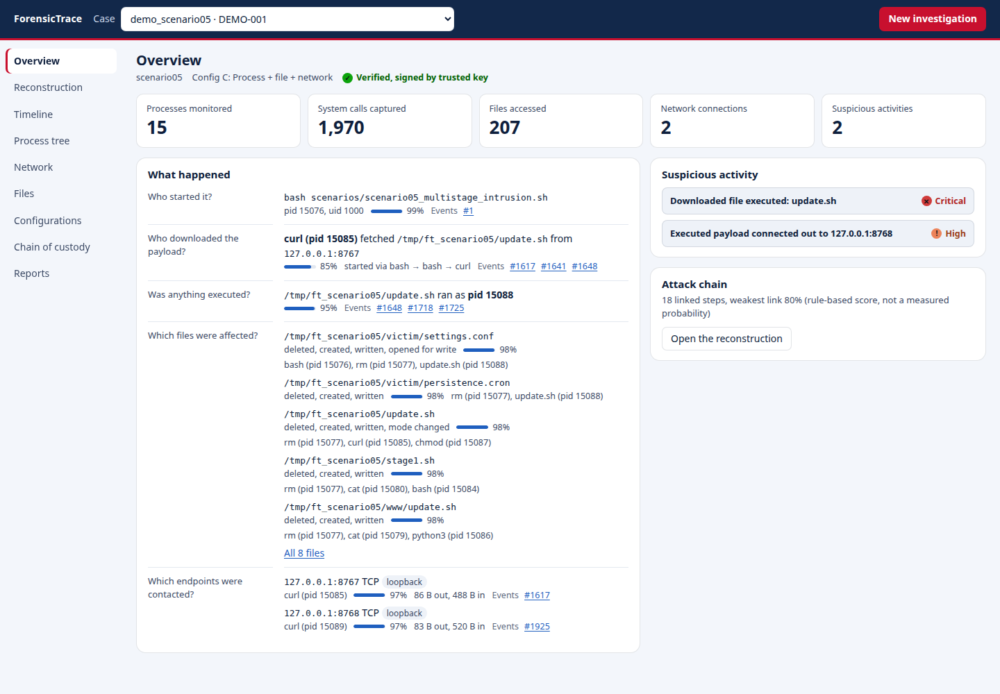

# ForensicTrace: A Plain-Language Report

**How much does a computer need to record to explain a cyber attack afterwards?**

Denaton Agbikossi, capstone project, African Leadership University, Rwanda. Supervisor: Junior Turatsinze. November 2026.

This is a short, non-technical version of the project. The full technical report covers the same work with all the detail.

## 1. The problem

When a computer is attacked, investigators need to answer simple questions. Who started it? What was downloaded? Which files were changed? Where did information go?

To answer them, the computer has to keep a record of what its programs did, much like a security camera keeps footage. Recording everything costs storage space and computer power, and buries investigators in detail. Recording too little means the important moment is missing when it is needed.

This project asks: **what is the smallest amount we need to record and still understand an attack?**

## 2. What was built

**ForensicTrace** is a recording tool for Linux computers. It watches a program while it runs and writes down each action the program asks the computer to do, such as starting another program, opening a file or connecting to another computer. It can record at four levels of detail:

| Level | What it records |
|---|---|
| A | Only which programs started and stopped |
| B | A, plus which files were opened, changed or deleted |
| C | B, plus which other computers were contacted |
| D | Everything, including thousands of routine actions |

The tool then puts the actions in order and links them, so that "this program started that one" and "this file was later run" can be followed like a story.

After feedback from the supervisor, four things were added:

- **A dashboard.** A web page, opened in a browser on the same computer, that shows the recording as a summary, a timeline and a map of what happened, so an investigator does not have to read thousands of raw entries.
- **A map of the incident.** Each step in the attack is drawn as a link between programs, files and other computers. Every link shows the evidence behind it, and how much evidence supports it.
- **Two reports for every investigation.** One is technical, for investigators. The other explains in everyday words what happened, how serious it is and whether the record can be trusted. Both can be downloaded as PDF.
- **Protection of the evidence.** Each record is linked to the one before it, and the whole set can be sealed with a digital signature, which works like a wax seal only the investigator's key can make. If anyone changes a record afterwards, the tool reports it, and usually names the record that was changed.

{width=82%}

## 3. How it was tested

Real attacks are dangerous to run, so four attacks were **simulated** safely on one laptop:

1. A file is downloaded, made runnable and run.
2. A program tries to read the computer's password file, then plants and deletes a fake user record.
3. A file is fetched from another computer and a script is run.
4. An important file is deliberately overwritten.

Each attack was recorded at all four levels, four times each: 64 recordings. Each recording was then checked against a list of what really happened in that attack, to see how much of the story it could reconstruct.

A fifth, longer attack was added later to demonstrate the map of the incident: a suspicious script downloads a harmful file, runs it, changes two files and contacts a second computer.

The software itself is checked by **127 automatic tests**. Nineteen of them deliberately tamper with the evidence in different ways, and the tool caught every one.

## 4. What was found

**Level C was enough.** Recording programs, files and connections to other computers was the smallest level that reconstructed all four attacks correctly, in every one of its 16 recordings.

**Level B fell short.** Without the network connections, it missed the moment a file was downloaded in two of the four attacks.

**Recording everything added nothing.** Level D gave no better answers than C, but took about **2.6 times** the storage.

**How the recording is done matters for cost.** With the tool's first method, the computer pauses at every action whether or not it is recorded, so recording less saved almost no computer power. A second method lets the computer itself skip actions that are not needed. With it, recording only programs (level A) used about **2.4 milliseconds** of the tool's own computer time, against about **40 milliseconds** for recording everything (level D).

**The map of the incident works on the tested attacks.** For the fifth attack, the tool identified the script that started it, the program that downloaded the harmful file, the address it came from, the two files the harmful file changed and the second computer it contacted. When a level did not record something, the dashboard says "not collected" instead of guessing.

**Protecting the evidence has a cost.** It makes each recording about 80% larger, while checking a recording takes less than a tenth of a second.

## 5. What this does not show

These limits matter as much as the results:

- **The attacks were simulated.** They were scripted by the researcher and run on one laptop, with no real attacker trying to hide. The result applies to these four attacks, not to every attack.
- **The tool records, it does not protect.** Like a camera, it helps explain what happened afterwards. It does not stop an attack.
- **A skilled attacker could defeat it.** The recording method can be noticed and switched off by an attacker with full control of the computer.
- **The confidence numbers are not accuracy scores.** A link marked "85%" means it is backed by several pieces of evidence, using rules the researcher wrote. It is not a measured chance of being right.
- **The scoring was done by a program, not by people.** Experts have not yet rated how understandable the results are.
- **The protection has limits too.** It depends on the investigator keeping their key safe. It shows that evidence was changed, but it is not a certified legal process.
- **The study is small.** Each condition was repeated four times on one laptop, so the numbers are indications, not proof.

## 6. Why it matters

Organisations have to decide what their computers record, and recording everything is expensive. This project shows, on a small scale, that there can be a sweet spot: in these tests, a moderate level of recording explained the attacks as well as recording everything, at a fraction of the storage. It also shows how a tool can explain its own conclusions and protect its evidence, so that an investigator can trust and check what it says.

The next steps would be to test on real incidents, to have security professionals rate the results, and to use a recording method that is harder for an attacker to defeat.

## Words used in this report

| Word | Meaning |
|---|---|
| Linux | An operating system, the basic software that runs a computer, like Windows |
| Program, process | Software that is running, such as a web browser |
| Recording level | How much detail the tool writes down |
| Reconstruct | Rebuild the story of what happened from the recording |
| Simulated attack | A safe, scripted imitation of an attack |
| Digital signature | A seal made with a secret key, which shows whether something was changed |
| Dashboard | A screen that summarises information at a glance |
| Millisecond | One thousandth of a second |
