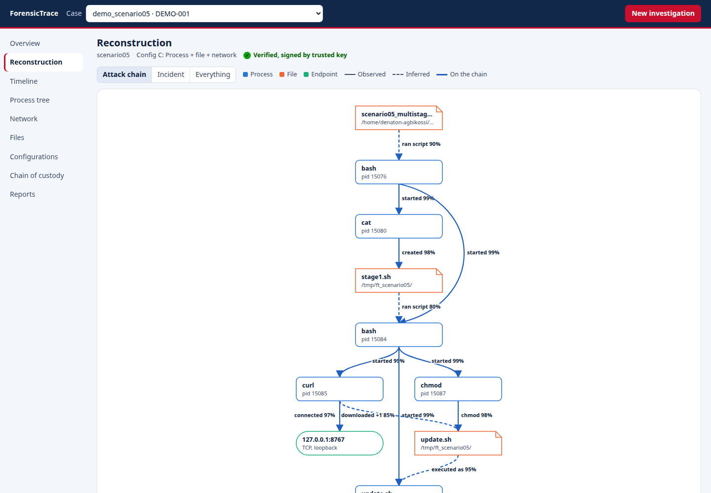
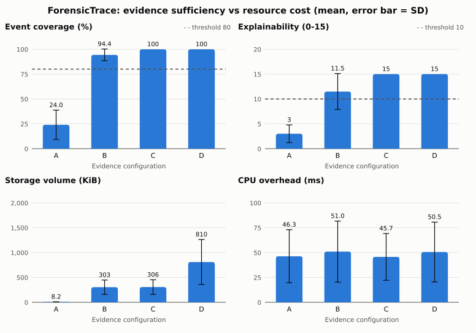

# ForensicTrace: Technical Report

**Evidence sufficiency and resource trade-offs in Linux incident reconstruction**

Repository: https://github.com/D-Agbikossi/ForensicTrace_Capstone_Final (walkthrough video and other deliverables are linked in the repository README)

*Revised November 2026.* After supervisor review, the tool gained a web dashboard, causal incident reconstruction and a chain of custody for its evidence. A plain-language version of this report, for readers without a technical background, is in `docs/report_for_general_readers.md`; both are built to PDF with `make reports`. Separately, every investigation produces its own technical and plain-language report (section 2). The study itself (sections 2 and 4) is unchanged. Its experiments still use the original evidence format, written with `--baseline-format`, so the published figures remain reproducible. Every new figure in this report was measured on the same laptop as the study.

## 1. Scope alignment and feature validation

ForensicTrace is a C11 tool that runs a command under `ptrace`, keeps only the system calls allowed by the chosen evidence configuration (A process, B + file, C + network, D all syscalls), correlates them and writes one JSON evidence file per run. A local web dashboard and a reconstruction layer read that evidence; neither replaces the engine. Scope is a research tool on one Linux host, not an enterprise DFIR platform. The experiment ran four scripted incidents under all four configurations, 4 repetitions each (64 runs per collection mode).

| Planned feature | Intended purpose | Status | Evidence |
|---|---|---|---|
| Process, file, network events via ptrace (FR1-3) | Record who ran what, which files, which connections | Completed. IPv6 is now decoded through the socket table in the custody format | `collector.c`; tests 4-7 |
| Raw syscall trace, configuration D (FR4) | Upper bound for comparison | Completed | test 8 |
| Normalised JSON events (FR5) | One common event form | Completed | `normaliser.c`, `json_writer.c` |
| Correlation by PID, PPID, time, resource (FR6) | Link events into causal chains | Completed | `correlator.c`; tests 9, 16 |
| Timeline and report (FR7, FR9) | Readable reconstruction | Completed | `reconstructor.c`, `report.c` |
| Configurations A-D (FR8) | The experimental variable | Completed | `ft_config_accepts()` |
| CPU, memory, storage, processing time (FR10) | The cost outcomes | Completed | `metrics.c`, JSON fields |
| JSON file with integrity hash (FR11) | Detect tampering | Completed, extended: sidecar hash, plus a hash chain, signed manifest and audit log | `integrity.c`, `custody.c`, `verify.c` |
| Four scenarios with ground truth; metrics; statistics | Answer the four research questions | Completed | `scenarios/`, `evaluate.py`, `analyze.py` |
| Seccomp collection mode | Not planned; added because plain ptrace CPU cost did not vary with the configuration | Completed (justified scope change) | tests 17-19 |
| Web dashboard | Not planned; added on supervisor feedback so an analyst need not read JSON | Completed | `dashboard/`; 38 checks |
| Incident reconstruction graph | Not planned; added on supervisor feedback to show causal relationships | Completed for five scripted scenarios; scores are rule-based, not calibrated | `reconstruct.py`; 32 checks |
| Chain of custody | Not planned (hash chains were out of scope); added on supervisor feedback | Completed | `custody.c`, `verify.c`; 34 checks |
| Investigation reports, technical and plain-language | Give each investigation a report an investigator can file and a non-specialist can read | Completed: built from the evidence for every case, viewable in the browser and downloadable as PDF | `case_report.py`; 4 checks |
| Project reports for technical and general readers | Make the study readable by assessors and by people without a technical background | Completed: both build to PDF with `make reports`; they are documents for assessors and are not served by the dashboard | `docs/`, `build_report.py`; 1 check |
| Kernel 5.x, Ubuntu 22.04 compatibility | Portability | Partial: tested on Ubuntu 24.04.4, kernel 7.0 only | Section 4 |
| ProvSec validation; expert explainability scoring | External validity; human check | Not implemented (both optional in the proposal) | Section 6 |

## 2. Technical functionality

**Pipeline.** `main.c` orchestrates the stages: collection, normalisation, correlation, reconstruction of the timeline, resource capture, custody sealing and storage. Each stage is in its own file and is timed separately. Custody work runs after the resource capture, so it is not charged to the study's cost measures.

**Collection.** The collector forks the command, sets `PTRACE_O_TRACEFORK/VFORK/CLONE/EXEC/EXITKILL`, and follows every descendant with `PTRACE_SYSCALL`. At each syscall entry it reads arguments from the tracee's memory (`process_vm_readv`), resolves relative paths with `/proc/<pid>/cwd` immediately (the process may exit later), and records the event. At exit it attaches the return value, which links a `fork` to the child it created and separates failed from successful calls. A table of the 22 recorded syscalls and their category drives both `ft_config_accepts()` and the seccomp filter, so each configuration has one definition. Events a configuration rejects are discarded before they count against the 20,000-event cap. In the custody format, when `connect()` or `accept()` returns, the collector also resolves the socket through `/proc/<pid>/net/{tcp,udp,tcp6,udp6}`, recording protocol, source and destination. The original arguments only reveal the far end.

**Seccomp mode.** The child installs a BPF filter built from the same table. Selected syscalls return `SECCOMP_RET_TRACE` and stop once; all others run without a stop. It records identical events (checked by an automated test), but CPU cost follows the configuration.

**Normalisation and correlation.** The normaliser drops the failed `execve` calls that `execvp` makes while searching `PATH`, canonicalises paths, carries each process's executable across forks, and annotates failed calls with the errno text. A denied read of `/etc/shadow` is kept, because the attempt is evidence. The correlator writes two backward links per event: `parent_event` (the previous event of the same PID, or the parent's `fork` whose return value is exactly this PID) and `resource_event` (the latest earlier event from any process on the same file or address). Because both only point backwards, the links form a DAG that the report and the evaluator walk to explain how an event came about.

**Chain of custody.** Each run gets a random session UUID, and records the investigator and case identifiers, OS user, host, kernel, and start and end times in UTC. Each event gets a unique `event_uid` and a UTC timestamp `ts_wall`, derived from the monotonic clock at session start. Events are hash-chained with SHA-256. Each field is hashed as `name=<byte length>:<value>`, so values cannot run into one another. The first link is a genesis hash over the session header, so records cannot be moved to another session. A manifest binds the file hash, event count, chain ends and report hash, and can be signed with Ed25519 into a detached signature that stock OpenSSL can check. A hash-chained audit log records generation, verification and export, with who did each. `forensictrace verify` recomputes everything with a strict JSON parser of its own, so it never trusts the file's layout. It names the record that was modified, missing, duplicated or out of order. A chain rewritten end to end is still caught by the signed manifest, provided the verifier pins the signer's public key. `forensictrace export` copies the evidence and its custody files to a bundle, and the bundle verifies on its own. The original report's main integrity limit was that an attacker could rewrite both the file and its sidecar; this closes it.

**Reconstruction.** `reconstruct.py` builds a graph of processes, files and network endpoints from one evidence file. *Observed* relations come straight from a syscall and its return value: a process started another, created, wrote, deleted or changed the mode of a file, or connected to an endpoint. *Inferred* relations connect observations the kernel never linked itself:

- **downloaded:** a process received network data, then wrote a file.
- **executed:** a file written during the trace was later executed.
- **ran script:** an interpreter read a file.

Every relation cites its event IDs and carries a score built from listed factors. For example, a download starts at 0.55, gains 0.15 if the bytes are tied to the connection by socket inode, 0.10 if no other file was read in between, and 0.05 if the bytes written fit within the bytes received. Inferred relations are capped below certainty because file contents and inodes are not captured. These scores rank how much evidence stands behind a claim. They are not measured probabilities and have not been calibrated. A chain is reported with its weakest link. Rules then flag suspicious activity, such as a downloaded file executed or a sensitive file accessed, each citing its events. Evidence that a configuration did not collect is reported as "not collected", never as "none".

**Dashboard.** A local web application (`dashboard/server.py`, Python standard library only) lists evidence, runs any of the five scenarios under any configuration, and shows:

- an overview with the five totals and plain answers to the investigator's questions;
- the reconstruction graph;
- an interactive timeline and the process tree;
- network and file activity;
- the A-D comparison from the study's stored results;
- chain of custody, with verify and export;
- a Reports page with two reports for the selected investigation, viewable in the browser or downloadable as PDF.

**Investigation reports.** `case_report.py` turns one evidence file into two reports. The *technical* version lists the case details, verification result, findings, the reconstructed sequence with the evidence and scoring factors of each step, every process, connection and affected file, the chain-of-custody checks and audit log, and the report's limits. The *plain-language* version is written for readers without a technical background. It tells what happened in a few generated sentences, for example "The program curl downloaded a file named update.sh from 127.0.0.1:8767 (an address on this same computer, so nothing left the machine). That file was then run as a program." It then says how serious each finding is, what was affected, whether the record can be trusted, and what the report cannot tell. Sentences are built only from relations and findings in the evidence. When a configuration did not collect something, the report says it is unknown. Both are HTML without script, with every value escaped, and print to PDF with headless Chromium. Where no browser is installed, such as on a hosting platform, the HTML version still opens and can be saved as PDF from the browser.

The interface uses a white page with a navy header, blue for structure and red for the main actions. The colours of the three event types were checked for colour-blind readers, and every chart also has a legend and a table, so colour never carries meaning alone.

It calls the engine for tracing, verification and export, and never collects or rewrites evidence itself. A `--public` mode and a `Dockerfile` publish it as a read-only demo on a hosting platform, where tracing is not possible because `ptrace` is blocked; GitHub Codespaces can run the full tool privately (`docs/deployment.md`, step 9). Evidence is treated as untrusted, because a traced program chooses its own file names, which reach the page. The server binds to 127.0.0.1, rejects other `Host` headers, requires a session token for state-changing requests, and only runs the listed scenario scripts. The page renders all evidence as text, under a content security policy that blocks inline script.

{width=74%}

**Evaluation.** `evaluate.py` matches ground-truth steps to events, checks that each *causal* relationship is reachable through the correlator's links, and scores coverage, accuracy, ordering and the five-dimension explainability rubric. `run_experiments.py` randomises run order with a fixed seed and pairs every run with an unmonitored baseline; `analyze.py` computes the statistics.

**Study results.** Configuration C met every threshold in all 64 runs (100% coverage, accuracy and ordering; 15/15 explainability). B missed the network `connect` step in scenarios 1 and 3 (worst explainability 8/15), A was insufficient, and D added no quality for 2.6x the storage and 2.9x the events of C.

**Reconstruction results.** Each scenario was run once per configuration on 11 November 2026. Scenario 5 is a reconstruction demonstration: a script fetches a payload, which runs, changes two files and connects to a second host. It is not part of the 64-run study.

| Scenario | Configuration C finds | Weakest link of the chain | Under B | Under A |
|---|---|---|---|---|
| 1 download + execute | curl downloaded `downloaded.sh` from 127.0.0.1:8765; it was executed | 85% (inferred download) | Execution found; download and endpoint "not collected" | File and network answers "not collected" |
| 2 privilege-related | `/etc/shadow` attempt by `cat`; fake record created then deleted | no chain (nothing downloaded or executed) | Same as C | Not collected |
| 3 network payload | `fetched.txt` downloaded; locally written `runme.sh` executed, not called a download | 90% | Execution found | Not collected |
| 4 file corruption | `important.txt` overwritten, then deleted | no chain | Same as C | Not collected |
| 5 multi-stage intrusion | script writer, script, downloader, payload, both changed files, both endpoints; 18 linked steps | 80% (bash ran `stage1.sh`) | 14 steps, without the download and connections | Not collected |

All endpoints in the scenarios are local servers. A separate single run downloaded a page from a public website (`example.com`, over IPv6). It reconstructed the download with its public endpoint and the DNS lookup before it. That run also exposed a labelling fault, described in section 3.

## 3. Testing approaches and results

`make test` now runs 127 checks: the original 23 acceptance tests and three new suites. All pass.

| Strategy | Why chosen | How conducted | Result and improvement |
|---|---|---|---|
| Functional and integration (`make test`, first 23) | Each requirement must be checked automatically and repeatably | Build with no warnings, CLI and validation, every configuration, correlation across processes, sidecar and tamper detection, end-to-end scenario, collection-mode equivalence | 23 of 23 pass. They lock in behaviour such as failed-`execve` removal, cross-process links and configuration filtering |
| Scenario validation against ground truth | The research claim depends on accurate reconstruction | 4 scenarios x 4 configurations x 4 repetitions, scored by `evaluate.py` | Results in section 2; also exposed the flat CPU result that led to seccomp mode |
| Adversarial custody testing (34 checks) | Tamper evidence must hold against someone who knows the format | Start from a signed run, then edit, delete, swap or duplicate records; cut the tail; hide an edit behind a duplicate JSON key; rewrite file, sidecar and whole chain; re-sign with an attacker's key; strip the signature; disguise the file as the old format; edit the report or audit log. The chain is also recomputed in Python from the written specification, and the signature checked with stock OpenSSL | 19 attacks, all detected; record-level attacks name the right record. **Found during design:** a pinned key must make an unsigned or schema 2 file fail, otherwise removing the signature would defeat it |
| Reconstruction against expected relations (32 checks) | Each inferred claim must be right on known incidents, and absent where untrue | All five scenarios run and checked for each expected relation. Negative controls: `ls`, a plain file write, a refused connection followed by a write, output to `/dev/null`, uncollected evidence | All pass. **Found:** `/dev/null` was reported as an overwritten file, and both ends of a loopback connection were counted twice. Both fixed |
| Dashboard end to end (38 checks) | The server handles untrusted evidence and can start a trace | Real binary behind it: foreign `Host` header, missing token, wrong content type, path traversal, a case ID that escapes the folder, a hostile file name inside evidence; then a full investigation, verify, report download, export, tampering and a destroyed file; both versions of an investigation report generate from the demo case, escape a hostile file name and download as PDF; the study reports are not served; the public read-only mode refuses every request that would run, log or export | All pass. **Found:** stored study runs were being checked against the investigator's key and failing; key selection now depends on the evidence folder |
| Browser checks (scripted, not part of `make test`) | The page must work as an analyst sees it | Headless Chromium 156 drove every view at 1440 px and 390 px wide, opened a case with an HTML-injection file name and a tampered case, clicked graph lines and dragged the timeline | No script errors, no horizontal overflow, injected markup stayed text. **Found:** the details panel printed `[object HTMLDivElement]`, and a graph link passed behind boxes. Both fixed |
| Real external download (single run) | Scripted scenarios only reach local servers | `curl` fetched `https://example.com` under configuration C | Download, public endpoint and DNS lookup reconstructed. **Found:** a shell whose last command replaces it was labelled with that later program ("rm started curl"). Fixed, and a test added |
| Regression of the study | New features must not change the published results | One repetition of the 16 ptrace conditions after the changes | Same quality figures as published (accuracy A 12.6%, B 91.25%, C and D 100%; explainability 3, 11.5, 15, 15); storage within 1% |
| Stress testing | Collectors fail at limits | 150 concurrent processes; 400 forks with 20,000+ events under D | **Found a defect:** processes beyond 64 concurrent were silently dropped. Fixed (limit 4,096, warning, `untraced_processes` field); test added. Event cap enforced and flagged `truncated` |
| Error handling and input variation | The tool must fail clearly | Invalid configuration or mode, missing command, unwritable output, nested output directory, a missing or invalid signing key, malformed and deeply nested JSON given to the verifier | Invalid arguments exit non-zero and write no file; a bad key fails before tracing starts; malformed input is reported as a failure without a crash |
| Memory safety | C code with raw buffers | Valgrind and an AddressSanitizer + UBSan build on scenarios and tests; the ASan build also ran the new trace, verify and export commands and the malformed inputs | No errors or leaks. Warnings found on the way (`-Wformat-truncation`, `-Wrestrict`) were fixed; the code builds with `-Wpedantic -Werror` |
| Integrity testing (study files) | Evidence must be tamper-evident | Flip one bit, append a byte, truncate the tail of each of the 64 files | 64 of 64 verified; every modification detected |

Inputs used: the five scenario scripts, `/bin/ls`, a process fan-out, a 400-iteration fork loop, a non-existent command, bad arguments, a public website, a hostile file name and deliberately corrupted evidence.

## 4. Performance and compatibility

**Environment tested.** Ubuntu 24.04.4, kernel 7.0, HP Laptop 14 (Intel Core i3-1115G4, 4 threads, 3.5 GiB RAM), bare metal with a normal desktop session running. Toolchain: gcc 13.3 (warning-free with `-Wall -Wextra -Wpedantic`), glibc 2.39, OpenSSL 3.0.13, Python 3.12.3 with pandas 2.2.2 and SciPy 1.17.1, and Chromium 156 for the dashboard. Not tested: Ubuntu 22.04, other distributions, other compilers, ARM, virtual machines, other hardware, other browsers. The tool is x86_64 only. The dashboard needs only the Python standard library, so it runs offline.

**Resource use of the study** (means over 4 scenarios x 4 repetitions; overhead is measured against an unmonitored run of the same script):

| Config | Events | Storage KiB | Processing ms | Tracer CPU ms, ptrace | Tracer CPU ms, seccomp |
|---|---|---|---|---|---|
| A | 23.5 | 8.2 | 0.06 | 38.1 | 2.4 |
| B | 833.0 | 303.5 | 1.52 | 41.7 | 19.0 |
| C | 840.5 | 306.0 | 1.63 | 39.3 | 19.0 |
| D | 2,447.5 | 809.7 | 4.21 | 43.1 | 40.0 |

Plain ptrace stops the tracee at the entry and exit of every syscall whether or not it is recorded, so CPU did not differ across configurations (tracer CPU Kruskal-Wallis p = 0.63, CPU overhead p = 0.95). With seccomp filtering it did (p < 0.001). D costs about the same as plain ptrace (40.0 against 43.1 ms) because it must stop on everything. Memory overhead did not vary in either mode (p = 0.97 and 0.70); it is dominated by the workload. Mean wall-time overhead was 39 to 48 ms for every configuration under ptrace (p = 0.92). Under seccomp it was -0.4, 25.0, 15.7 and 31.8 ms for A to D (p < 0.001). B above C is run-to-run noise (SD 34 ms for B), and A's slightly negative value shows the noise floor of a desktop machine. Storage and processing time grow with the evidence set under both modes. The environment of each run set is saved in `environment.json`.

{width=78%}

**Cost of the chain of custody.** Measured on 11 November 2026: each of the four study scenarios was run three times in both formats, under configurations C and D (12 pairs each, ptrace mode):

| Config | Mean events | Extra storage | Extra per event | Chain time, mean (max) | Per event |
|---|---|---|---|---|---|
| C | 841 | +78% (77 to 78%) | 293 B | 3.7 ms (8.7) | 4.1 µs |
| D | 2,448 | +85% (85 to 86%) | 292 B | 9.1 ms (15.5) | 3.7 µs |

The extra storage is almost all hashes and identifiers. Hashing scales linearly with the number of events and is small next to the tracer's own CPU cost. Verifying one file, including process start, took 19 ms on average (maximum 41 ms) over 24 files of 841 to 2,448 events. These are small samples on one machine, so they are indicative only. The socket lookup added to the collector was not measured separately.

## 5. Code quality and technical implementation

**Structure.** About 3,900 lines of C in eleven source files and one header, one file per pipeline stage, of which `custody.c` (635 lines) and `verify.c` (918 lines) are new. Analysis and statistics are in Python (`reconstruct.py` alone is 990 lines, and `case_report.py`, which writes the investigation reports, about 520). The dashboard has a 420-line Python server and about 1,500 lines of JavaScript and CSS with no dependencies. There are about 1,000 lines of tests. `main.c` only orchestrates.

**Object-oriented principles in C.** C has no classes, so the principles are applied through structure.

- *Encapsulation:* state lives in one `FTContext`, with custody state in its `FTCustody` member, created and destroyed through `ft_ctx_create/destroy`. File-local helpers are `static`.
- *Abstraction:* `forensictrace.h` is the only interface between stages.
- *Separation of concerns:* collection, normalisation, correlation, reconstruction, reporting, measurement, storage, custody and verification are separate compilation units. Collection, analysis and presentation are also separate programs: the engine, `reconstruct.py` and the dashboard communicate only through the evidence file.
- *Open/closed:* behaviour is table-driven. A recorded syscall is one row in the syscall table, and each hashed field is one name in a field list shared by writer and verifier.
- *Single responsibility:* shared helpers (`ft_type_name`, `ft_is_exec`, `ft_is_fork`, `ft_sha256_file`, `ft_hash_fields`) replaced copies in several files.

Inheritance does not apply. Honest limits: one header exposes every stage's function, and the tracee table in `collector.c` is file-level state, so one trace can run per process.

**Algorithms and problem solving.**

1. Backward-link correlation: a per-PID chain, an exact match between a child's PID and the parent's `fork` return value, and a bounded look-back fallback, plus a resource index that links a write in one process to a `chmod` or exec in another.
2. Stack-based path canonicalisation.
3. Generation of a BPF program from the syscall table.
4. A seccomp stop protocol that records at entry and resumes with `PTRACE_SYSCALL` to catch the exit stop.
5. A fixed-point rewrite so the JSON file stores its own size.
6. A hash chain over length-prefixed fields, and a strict recursive-descent JSON parser for the verifier. The parser rejects embedded NUL characters and lets the last duplicate key win, as other readers do, so a crafted file cannot show one value and hash another.
7. Ed25519 signing of a manifest, verified against a pinned public key, with a downgrade rule so removing the signature does not pass.
8. Rule-based inference with stated factors, and a weakest-link score for a chain.
9. A layered graph layout (longest-path layering and barycentre ordering), with links that would pass behind a box routed around it.
10. Step matching with ordering constraints and a reachability search over correlator links in the evaluator.
11. Kruskal-Wallis, Dunn with Bonferroni correction and eta-squared in `analyze.py`.

**Readability and maintainability.** The code uses a consistent `ft_` prefix and snake_case, with a comment at the top of each file stating its role. It builds clean under gcc with `-Wall -Wextra -Wpedantic`. The `Makefile` has `all`, `test`, `asan`, `keys`, `dashboard` and `reports` targets, and a CI workflow is set up to run the build and the tests. Documentation is in `docs/`: this report, a plain-language report for general readers, limitations, deployment, dashboard, chain of custody and example traces. `docs/custody.md` specifies the hash format exactly enough to reimplement the verifier, and one test does so in Python.

## 6. Scope changes and limitations

**Changes.**

- Seccomp mode was added.
- The integrity hash moved to a sidecar, then was extended with a hash chain, signed manifest and audit log.
- A custom JSON writer is used instead of a library.
- `getrusage` is used instead of `perf`.
- The collector now records protocol and source address in the custody format.
- After supervisor review, the dashboard, reconstruction and fifth scenario were added. Each investigation now produces a technical and a plain-language report, and the study itself has a second report for readers without a technical background.
- `--baseline-format` keeps the study's original evidence format, which the experiment runner always uses.

**Limits of the study.**

- Four scripted scenarios on one host.
- Explainability is scored automatically and has not been checked by human experts.
- n = 4 per condition, so results are indicative, not confirmatory.
- Tracing is x86_64 and user space only.
- Timing is specific to the environment.

**Limits of the new features.**

- *Confidence scores:* rule-based and uncalibrated. Inferred links such as a download are plausible but never proven.
- *Reconstruction testing:* only five scripted scenarios, written by the same person who wrote the rules, with no adversary. Apart from the single public download, every endpoint was local. This shows the logic works as designed, not how well it detects real intrusions.
- *Custody:* depends on keeping the private key away from the machine under investigation; by default it sits on the same disk. Events are sealed when the run ends, so a compromised tracer could alter them before hashing. The audit log is chained but not signed, so its newest entries could be removed unnoticed. Timestamps come from the system clock, with no trusted timestamp authority. The investigator name is typed by the operator, not authenticated. A chain rewritten end to end is detected, but the changed records cannot then be located.
- *Dashboard:* local and single-user, with no login, so it must not be exposed to a network. It starts only the listed scenarios; any other command is traced from the command line. No analyst has yet evaluated it.

The full list is in `docs/limitations.md`, `docs/custody.md` and `docs/dashboard.md`.

## Author

Denaton Agbikossi

## Supervisor

Junior Turatsinze
