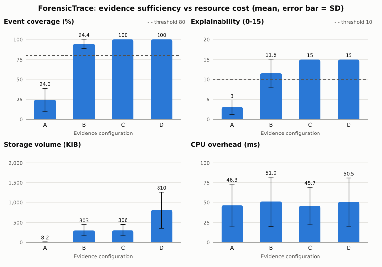

# ForensicTrace: Technical Report

**Evidence sufficiency and resource trade-offs in Linux incident reconstruction** 

Repository: https://github.com/D-Agbikossi/ForensicTrace_Capstone_Final (walkthrough video and other deliverables are linked in the repository README)

## 1. Scope alignment and feature validation

This is the **final ForensicTrace product** (not a work-in-progress prototype). It is a C11 command-line tool that runs a command under `ptrace`, keeps only the system calls allowed by the chosen evidence configuration (A process, B + file, C + network, D all syscalls), correlates them, prints a timeline, writes a report, and saves one JSON file with a SHA-256 sidecar. Scope is the approved research tool on one Linux host; it is not an enterprise DFIR platform. The experiment ran four scripted incidents under all four configurations, 4 repetitions each (64 runs per collection mode).

| Planned feature | Intended purpose | Status | Evidence |
|---|---|---|---|
| Process, file, network events via ptrace (FR1-3) | Record who ran what, which files, which connections | Completed (IPv6 address not decoded) | `collector.c`; tests 4-7 |
| Raw syscall trace, configuration D (FR4) | Upper bound for comparison | Completed | test 8 |
| Normalised JSON events (FR5) | One common event form | Completed | `normaliser.c`, `json_writer.c` |
| Correlation by PID, PPID, time, resource (FR6) | Link events into causal chains | Completed | `correlator.c`; tests 9, 16 |
| Timeline and report (FR7, FR9) | Readable reconstruction | Completed | `reconstructor.c`, `report.c` |
| Configurations A-D (FR8) | The experimental variable | Completed | `ft_config_accepts()` |
| CPU, memory, storage, processing time (FR10) | The cost outcomes | Completed | `metrics.c`, JSON fields |
| JSON file with integrity hash (FR11) | Detect tampering | Completed, changed: hash in a sidecar file (a file cannot hold its own hash) | `integrity.c`; tests 10-11 |
| Four scenarios with ground truth; metrics; statistics | Answer the four research questions | Completed | `scenarios/`, `evaluate.py`, `analyze.py` |
| Seccomp collection mode | Not planned; added because plain ptrace CPU cost did not vary with the configuration | Completed (justified scope change) | tests 17-19 |
| Kernel 5.x, Ubuntu 22.04 compatibility | Portability | Partial: tested on Ubuntu 24.04.4, kernel 7.0 only | Section 4 |
| ProvSec validation; expert explainability scoring | External validity; human check | Not implemented (both optional in the proposal) | |

## 2. Technical functionality

**Pipeline.** `main.c` runs five stages, each in its own file and timed separately: collection, normalisation, correlation, reconstruction, storage.

**Collection.** The collector forks the command, sets `PTRACE_O_TRACEFORK/VFORK/CLONE/EXEC/EXITKILL`, and follows every descendant with `PTRACE_SYSCALL`. At each syscall entry it reads arguments from the tracee's memory (`process_vm_readv`), resolves relative paths with `/proc/<pid>/cwd` immediately (the process may exit later), and records the event; at exit it attaches the return value, which links a `fork` to the child it created and separates failed from successful calls. A table of the 22 recorded syscalls and their category drives both `ft_config_accepts()` and the seccomp filter, so there is one definition of each configuration. Events a configuration rejects are discarded before they count against the 20,000-event cap.

**Seccomp mode.** The child installs a BPF filter built from the same table; selected syscalls return `SECCOMP_RET_TRACE` and stop once, all others run without a stop. It records identical events (checked by an automated test) but CPU follows the configuration.

**Normalisation and correlation.** The normaliser drops the failed `execve` calls that `execvp` makes while searching `PATH`, canonicalises paths, carries each process's executable across forks, and annotates failed calls with the errno text (a denied read of `/etc/shadow` is kept because the attempt is evidence). The correlator writes two backward links per event: `parent_event` (previous event of the same PID, or the parent's `fork` whose return value is exactly this PID) and `resource_event` (latest earlier event from any process on the same file or address). Because both only point backwards, the links form a DAG that the report and the evaluator walk to explain how an event came about.

**Storage and integrity.** One JSON file per run records its own size by rewriting until the stored value equals the real size; the SHA-256 of the finished file goes in `<file>.sha256`.

**Evaluation.** `evaluate.py` matches ground-truth steps to events, checks that each *causal* relationship is reachable through the correlator's links, and scores coverage, accuracy, ordering and the five-dimension explainability rubric. `run_experiments.py` randomises run order with a fixed seed and pairs every run with an unmonitored baseline; `analyze.py` computes the statistics.

**Results.** Configuration C met every threshold in all 64 runs (100% coverage, accuracy, ordering; 15/15 explainability). B missed the network `connect` step in scenarios 1 and 3 (explainability 8/15), A was insufficient, and D added no quality for 2.6x the storage and 2.9x the events of C.

## 3. Testing approaches and results

| Strategy | Why chosen | How conducted | Result and improvement |
|---|---|---|---|
| Functional and integration (`make test`) | Each requirement must be checked automatically and repeatably | 23 shell tests: build with no warnings, CLI and validation, every configuration, correlation across processes, sidecar and tamper detection, end-to-end scenario, collection-mode equivalence | 23 of 23 pass. They lock in behaviour such as failed-`execve` removal, cross-process links and configuration filtering |
| Scenario validation against ground truth | The research claim depends on accurate reconstruction | 4 scenarios x 4 configurations x 4 repetitions, scored by `evaluate.py` | Results in Section 2; also exposed the flat CPU result that led to seccomp mode |
| Stress testing | Collectors fail at limits | 150 concurrent processes; 400 forks with 20,000+ events under D | **Found a defect:** processes beyond 64 concurrent were silently dropped. Fixed (limit 4,096, warning, `untraced_processes` field); test added. Event cap is enforced and flagged `truncated` |
| Error-handling and input variation | Tool must fail clearly | Invalid configuration or mode, missing command, unwritable output path, nested output directory | Invalid arguments exit non-zero with usage and write no file; a missing command still yields a valid, verifiable evidence file; an unwritable path fails with a message |
| Memory safety | C code with raw buffers | Valgrind; AddressSanitizer + UBSan build (`make asan`) on scenarios and tests | No errors or leaks. Compiler warnings found on the way (`-Wformat-truncation`, `-Wrestrict`) were fixed |
| Integrity testing | Evidence must be tamper-evident | Flip one bit, append a byte, truncate the tail of each of the 64 files | 64 of 64 verified; every modification detected |

Different inputs used: the four scenario scripts, `/bin/ls`, a process fan-out, a 400-iteration fork loop, a non-existent command and bad arguments.

## 4. Performance and compatibility

**Environment tested.** Ubuntu 24.04.4, kernel 7.0, HP Laptop 14 (Intel Core i3-1115G4, 4 threads, 3.5 GiB RAM), bare metal with a normal desktop session running, gcc 13.3 (warning-free with `-Wall -Wextra -Wpedantic`), glibc 2.39, OpenSSL 3.0.13, Python 3.12.3 with pandas 2.2.2 and SciPy 1.17.1. Not tested: Ubuntu 22.04, other distributions, other compilers, ARM, virtual machines, other hardware classes. The tool is x86_64 only.

**Resource use** (means over 4 scenarios x 4 repetitions; overhead is measured against an unmonitored run of the same script):

| Config | Events | Storage KiB | Processing ms | Tracer CPU ms, ptrace | Tracer CPU ms, seccomp |
|---|---|---|---|---|---|
| A | 23.5 | 8.2 | 0.06 | 38.1 | 2.4 |
| B | 833.0 | 303.5 | 1.52 | 41.7 | 19.0 |
| C | 840.5 | 306.0 | 1.63 | 39.3 | 19.0 |
| D | 2,447.5 | 809.7 | 4.21 | 43.1 | 40.0 |

Plain ptrace stops the tracee at the entry and exit of every syscall whether or not it is recorded, so CPU did not differ across configurations (tracer CPU Kruskal-Wallis p = 0.63, CPU overhead p = 0.95). With seccomp filtering it did (p < 0.001), and D costs about the same as plain ptrace (40.0 against 43.1 ms) because it must stop on everything. Memory overhead did not vary in either mode (p = 0.97 and 0.70); it is dominated by the workload. Mean wall-time overhead was 39 to 48 ms for every configuration under ptrace (p = 0.92) and -0.4, 25.0, 15.7 and 31.8 ms for A to D under seccomp (p < 0.001); B above C is run-to-run noise (SD 34 ms for B), and A's slightly negative value shows the noise floor of a desktop machine. Storage and processing time grow with the evidence set under both modes. The environment of each run set is saved in `environment.json`.

{width=78%}

## 5. Code quality and technical implementation

**Structure.** About 2,100 lines of C in nine files, one per pipeline stage, plus about 1,250 lines of Python and shell for evaluation and statistics and a 290-line test suite. No file does more than one job; `main.c` only orchestrates.

**Object-oriented principles in C.** C has no classes, so the principles are applied through structure. *Encapsulation:* state lives in one `FTContext` created and destroyed through `ft_ctx_create/destroy`, and file-local helpers are `static`, so each module exposes only its stage function. *Abstraction:* `forensictrace.h` is the only interface between stages. *Separation of concerns and modularity:* collection, normalisation, correlation, reconstruction, reporting, measurement and storage are separate compilation units that can be tested and timed alone. *Polymorphism and open/closed:* behaviour is table-driven; adding a recorded syscall is one row in the syscall table and both the configuration filter and the kernel filter follow. *Single responsibility:* shared helpers (`ft_type_name`, `ft_is_exec`, `ft_is_fork`) replaced copies that existed in several files. Inheritance does not apply. Honest limits: one header exposes every stage's function, and the tracee table in `collector.c` is file-level state, so one trace can run per process.

**Algorithms and problem solving.** (1) Backward-link correlation: a per-PID chain, an exact match between a child's PID and the parent's `fork` return value, and a bounded look-back fallback, plus a resource index that links a write in one process to a `chmod` or exec in another. (2) Stack-based path canonicalisation. (3) Generation of a BPF program from the syscall table. (4) A seccomp stop protocol that records at entry and resumes with `PTRACE_SYSCALL` to catch the exit stop. (5) A fixed-point rewrite so the JSON file stores its own size. (6) Step matching with ordering constraints and a reachability search over correlator links in the evaluator. (7) Kruskal-Wallis, Dunn with Bonferroni correction and eta-squared in `analyze.py`.

**Readability and maintainability.** Consistent `ft_` prefix and snake_case, a comment at the top of each file stating its role, builds clean under gcc with `-Wall -Wextra -Wpedantic`, a `Makefile` with `all`, `test` and `asan` targets, and documentation in `docs/` (technical report, limitations, example traces).

## 6. Scope changes and limitations

Changes: seccomp mode added; integrity hash moved to a sidecar; custom JSON writer instead of a library; `getrusage` instead of `perf`. Limits: four scripted scenarios on one host, automated explainability scoring, n = 4 per condition (indicative, not confirmatory), x86_64 and user-space tracing only, and environment-specific timing. The full list is in `docs/limitations.md`.

## Author

Denaton Agbikossi

## Supervisor

Junior Turatsinze